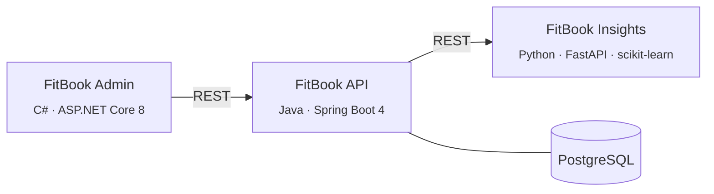

### Ahoj 👋

Studuji **aplikovanou informatiku na VŠPJ** a hledám první práci jako **junior vývojář**. Baví mě backend, ale nebojím se frontendu, mobilu ani algoritmů – všechno s testy, v Gitu a s CI.

🌐 **Portfolio:** [neubauerlukas207-cell.github.io](https://neubauerlukas207-cell.github.io)

---

#### 🏋️ Hlavní projekt: FitBook

Systém pro fitness centrum ze tří služeb ve třech jazycích. Každá má testy, Docker obraz a CI v GitHub Actions.

| Projekt | Co ukazuje |
|---|---|
| [**fitbook-api**](https://github.com/neubauerlukas207-cell/fitbook-api) | REST API, JPA, Flyway, pesimistické zámky proti přeplnění lekcí, ProblemDetail chyby, 27 testů, e2e test celého systému v CI |
| [**fitbook-admin**](https://github.com/neubauerlukas207-cell/fitbook-admin) | ASP.NET Core MVC, EF Core, Identity s rolemi, `TimeProvider`, integrační testy přes `WebApplicationFactory` |
| [**fitbook-insights**](https://github.com/neubauerlukas207-cell/fitbook-insights) | ML model porovnaný křížovou validací (MAE 0,059 vs. 0,181 baseline), FastAPI, Pydantic, 23 testů |

#### 🎓 Ze školy

| Projekt | |
|---|---|
| [pjp-compiler](https://github.com/neubauerlukas207-cell/pjp-compiler) | překladač podmnožiny Pascalu do tříadresného kódu (flex + bison) |
| [android-apps](https://github.com/neubauerlukas207-cell/android-apps) | směnárna s kurzy ČNB, BMI kalkulačka – Android, Java |
| [vehicle-registry-cpp](https://github.com/neubauerlukas207-cell/vehicle-registry-cpp) | AVL strom, hashovací tabulka a halda od nuly v C++ |
| [ai-matlab](https://github.com/neubauerlukas207-cell/ai-matlab) | A*, minimax, MCTS, neuronové sítě, transfer learning |
| [fitko-symfony](https://github.com/neubauerlukas207-cell/fitko-symfony) | webová aplikace v Symfony s přihlašováním a rolemi |
| [advanced-programming-java](https://github.com/neubauerlukas207-cell/advanced-programming-java) | JUnit 5, oprava chyb, návrhové vzory |

…a [další](https://github.com/neubauerlukas207-cell?tab=repositories) – historie commitů odpovídá skutečným datům odevzdání.

#### 🛠️ Technologie

